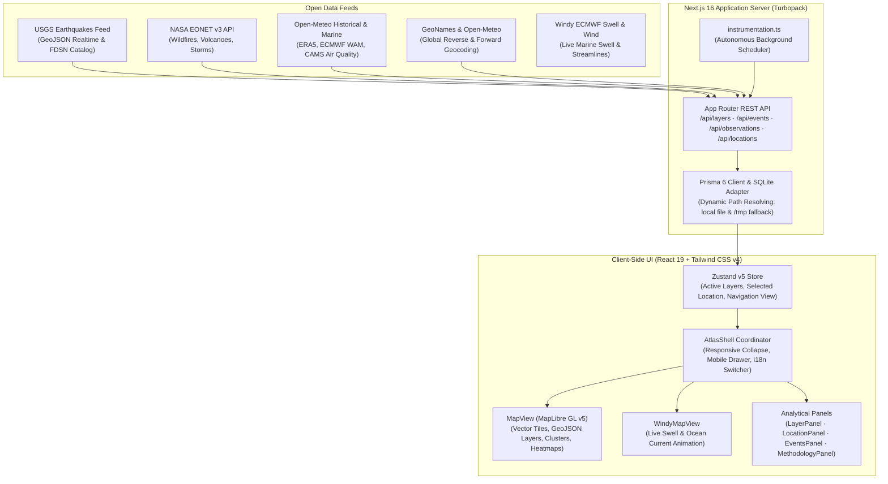

<div align="center">

# 🌍 WorldRisk Atlas

**An Open, Transparent, Real-Time Global Map & Analytical Intelligence Platform for Natural Hazards, Climatological Trends, and Documented Disasters.**

[](https://world-risk-murex.vercel.app)
[](LICENSE)
[](https://nextjs.org/)
[](https://react.dev/)
[](https://www.typescriptlang.org/)
[](https://bun.sh/)
[](https://tailwindcss.com/)
[](https://maplibre.org/)
[](https://github.com/sopu175/world-risk/actions/workflows/staging-auto-merge.yml)

Explore live seismic events, active wildfires, flood risk zones, tropical cyclones, extreme heat anomalies, volcanic eruptions, and ocean wave dynamics on an interactive vector map. Inspect any coordinate or city on Earth for historical seismicity, ERA5 climatology, and atmospheric air quality — with zero synthetic risk scores, zero fabricated data, and complete open-source attribution.

*Full Bilingual Support: English & Bengali (বাংলা)*

---

</div>

## 📑 Table of Contents

1. [About the Project (A to Z)](#-about-the-project-a-to-z)
   - [Mission & Philosophy](#mission--philosophy)
   - [Why This Project Exists](#why-this-project-exists)
2. [Key Capabilities & Features](#-key-capabilities--features)
3. [System Architecture](#-system-architecture)
4. [How We Built It: Resources & Technical Deep-Dive](#-how-we-built-it-resources--technical-deep-dive)
   - [1. Next.js 16 App Router & Turbopack](#1-nextjs-16-app-router--turbopack)
   - [2. MapLibre GL v5 & OpenFreeMap](#2-maplibre-gl-v5--openfreemap)
   - [3. Windy Live Waves & Atmospheric Flow](#3-windy-live-waves--atmospheric-flow)
   - [4. Climatology Analytics via Open-Meteo & ERA5](#4-climatology-analytics-via-open-meteo--era5)
   - [5. Resilient Database & Path Resolution (Prisma + SQLite)](#5-resilient-database--path-resolution-prisma--sqlite)
   - [6. Lightweight Bilingual i18n Architecture](#6-lightweight-bilingual-i18n-architecture)
   - [7. Responsive & "User-Free" UX Design](#7-responsive--user-free-ux-design)
5. [Open Data Providers & Attribution](#-open-data-providers--attribution)
6. [Repository Structure](#-repository-structure)
7. [Getting Started (Step-by-Step)](#-getting-started-step-by-step)
   - [Prerequisites](#prerequisites)
   - [Installation](#installation)
   - [Environment Variables](#environment-variables)
   - [Database Synchronization](#database-synchronization)
   - [Running Locally](#running-locally)
8. [Developer Tutorials & Guides](#-developer-tutorials--guides)
   - [Tutorial 1: How to Add a New Hazard Layer](#tutorial-1-how-to-add-a-new-hazard-layer)
   - [Tutorial 2: How to Add Translations](#tutorial-2-how-to-add-translations)
   - [Tutorial 3: Triggering & Testing Data Ingestion](#tutorial-3-triggering--testing-data-ingestion)
9. [Automated CI/CD & Production Deployment](#-automated-cicd--production-deployment)
10. [Contributing Guidelines](#-contributing-guidelines)
11. [License & Acknowledgments](#-license--acknowledgments)

---

## 💡 About the Project (A to Z)

### Mission & Philosophy
The **WorldRisk Atlas** is an independent, scientific, and community-driven initiative built to bring **complete transparency** to global disaster risk, atmospheric observations, and climatological data.

Many commercial catastrophe-modeling products operate as "black boxes." They take diverse environmental phenomena and collapse them into a single arbitrary score (e.g., *"Overall Risk: 82/100"*). This obscures uncertainty, hides gaps in data, and prevents local communities, civil protection agencies, and independent researchers from auditing how hazard assessments are made.

**WorldRisk Atlas operates on 4 immutable principles:**
1. **Zero Fabricated Risk Scores:** We do not compute synthetic composite scores or color entire countries red or green based on subjective weighting.
2. **Native Provenance:** Every point, circle, and polygon links directly to its source agency ID (USGS, NASA, Copernicus, NOAA, etc.).
3. **Transparent Data Gaps:** If an environmental peril currently lacks an open, validated real-time satellite or sensor feed (e.g., localized flash flood forecasting in un-instrumented basins), the platform explicitly documents that limitation rather than inventing synthetic numbers.
4. **Accessible to All:** Zero paywalls, zero closed APIs, and responsive mobile-first accessibility across multiple languages.

---

## ⚡ Key Capabilities & Features

* **Interactive Vector Map (MapLibre GL v5):**
  - Magnitude-proportional seismic circles with real-time USGS M2.5+ earthquake telemetry.
  - NASA EONET thermal anomaly alerts for active wildfires and volcanic eruptions.
  - Tropical cyclone tracks, central pressures, and verified historical paths.
  - Interactive clustering, hover inspection cards, and custom coordinate fly-to animations.
* **Windy Waves & Wind Flow Animation:**
  - Dedicated interactive live ocean wave heights, sea surface wind streamlines, and swell animations integrated with global Windy forecasts.
* **Location Intelligence & Climatology Engine:**
  - Tap any spot on the globe or search over 100,000 cities via GeoNames and Open-Meteo geocoders.
  - **10-Year Seismic Catalog:** Direct geospatial bounding-circle query within 300 km for $M \ge 4.5$ earthquakes.
  - **30-Year Extreme Heat Analysis:** Decadal ERA5 reanalysis tracking annual hot days ($T_{\text{max}} \ge 35^\circ\text{C}$ and $40^\circ\text{C}$) from 1995 to the present day.
  - **Surface Wind Distribution:** 10 m wind vectors, historical gusts, and decadal wind extremes.
  - **Copernicus CAMS Air Quality:** Rolling 72-hour PM2.5 atmospheric concentration levels.
* **Documented Disasters Archive:**
  - Chronological natural disaster catalog with dual-tier verification (`source_reported` vs. `cross_verified`).
  - Searchable by peril category, severity metrics, affected regions, and date ranges.
* **User-Free & Responsive Layout:**
  - Desktop users can freely collapse the left panel using `[ ◀ ]` for an edge-to-edge full-screen map experience, or restore it using floating controls.
  - Mobile users receive a dedicated drawer sheet that automatically updates its content based on whether they are exploring map layers or the disaster events archive.
  - Independent smooth scrolling across all side panels without layout clipping.
* **Instant Bilingual i18n:**
  - Fast, client-side language switching between English and Bengali (`বাংলা`) with persistent preferences and translated hazard titles.

---

## 🏗 System Architecture



---

## 🛠 How We Built It: Resources & Technical Deep-Dive

This section explains how each major component was built, why particular tools were selected, and how other developers can replicate or adapt these techniques in their own geospatial applications.

### 1. Next.js 16 App Router & Turbopack
* **Why We Selected It:** Next.js 16 provides unmatched server-side performance, native API routing without needing a separate backend service, and Turbopack for near-instant hot module reloading during development.
* **Implementation Highlights:**
  - Backend endpoints are organized cleanly under `src/app/api/` (e.g., `/api/layers`, `/api/events`, `/api/locations/detail`).
  - Standalone build optimization (`output: "standalone"`) generates lightweight production bundles suitable for Docker or serverless runtimes.
* **Helpful Resource for Developers:** [Next.js Documentation](https://nextjs.org/docs)

### 2. MapLibre GL v5 & OpenFreeMap
* **Why We Selected It:** Unlike commercial mapping libraries that mandate expensive per-tile billing, [MapLibre GL](https://maplibre.org/) is a community-governed, high-performance open-source WebGL/WebGPU mapping engine.
* **Vector Tiles:** We paired MapLibre GL with **[OpenFreeMap](https://openfreemap.org/)**, which delivers free vector tile basemaps (`positron` style) derived from OpenStreetMap with zero rate limits or API key requirements.
* **Implementation Highlights:**
  - Fast clustering for point observations:
    ```ts
    map.addSource("earthquakes-src", {
      type: "geojson",
      data: geojsonData,
      cluster: true,
      clusterMaxZoom: 8,
      clusterRadius: 40,
    });
    ```
  - Magnitude-proportional circle radius interpolation:
    ```ts
    "circle-radius": [
      "interpolate", ["linear"], ["get", "magnitude"],
      2.5, 4,
      5.0, 9,
      7.0, 18,
      9.0, 32
    ]
    ```
* **Helpful Resource for Developers:** [MapLibre GL JS Documentation](https://maplibre.org/maplibre-gl-js/docs/)

### 3. Windy Live Waves & Atmospheric Flow
* **Why We Selected It:** For ocean wave swell heights and surface wind stream animations, Windy provides one of the world's most accurate global models (incorporating ECMWF and GFS data).
* **Implementation Highlights:**
  - Created a seamless, reactive viewport component [`WindyMapView.tsx`](file:///Users/saif-dc/Dcastalia/Node%20JS%20Projects/world-risk/src/components/atlas/WindyMapView.tsx) that passes active map coordinates and zoom levels directly into the interactive stream viewer.
* **Helpful Resource for Developers:** [Windy Web Embed API](https://www.windy.com/)

### 4. Climatology Analytics via Open-Meteo & ERA5
* **Why We Selected It:** [Open-Meteo](https://open-meteo.com/) provides high-resolution historical and forecast weather APIs under open CC-BY 4.0 licensing without requiring complex API credentials for non-commercial open data projects.
* **Implementation Highlights:**
  - In [`src/lib/services/location-intelligence.ts`](file:///Users/saif-dc/Dcastalia/Node%20JS%20Projects/world-risk/src/lib/services/location-intelligence.ts), when a user clicks on the map, we query the ERA5 archive to compute 30-year decadal trends:
    - Annual count of extreme heat days ($T_{\text{max}} \ge 35^\circ\text{C}$).
    - 72-hour rolling particulate matter (PM2.5) concentrations from Copernicus CAMS.
* **Helpful Resource for Developers:** [Open-Meteo Historical Weather Documentation](https://open-meteo.com/en/docs/historical-weather-api)

### 5. Resilient Database & Path Resolution (Prisma + SQLite)
* **The Challenge:** In serverless environments like Vercel, the local filesystem is read-only at runtime except for the `/tmp` directory, and SQLite path resolution differences between local dev, standalone builds, and Prisma engines often cause `Unable to open database file` errors.
* **The Solution:** We implemented an adaptive database resolver in [`src/lib/db.ts`](file:///Users/saif-dc/Dcastalia/Node%20JS%20Projects/world-risk/src/lib/db.ts):
  - It sequentially checks local relative paths, current working directory paths, and copies the seeded starter database to `/tmp/worldrisk.db` in serverless production environments.
  - Allows the repository to run straight out-of-the-box with zero database configuration!
* **Helpful Resource for Developers:** [Prisma ORM SQLite Guide](https://www.prisma.io/docs/orm/overview/databases/sqlite)

### 6. Lightweight Bilingual i18n Architecture
* **The Challenge:** Traditional i18n packages often inject heavyweight dependencies, require server restarts, or break client-side rendering during static export.
* **The Solution:** In [`src/lib/i18n.ts`](file:///Users/saif-dc/Dcastalia/Node%20JS%20Projects/world-risk/src/lib/i18n.ts), we engineered an ultra-fast, zero-overhead Zustand-backed localization module:
  - English and Bengali (`বাংলা`) string dictionaries for every UI key.
  - Synchronous switching without page reload.
  - Automatic localStorage persistence.
  - Safe fallback for missing translations.

### 7. Responsive & "User-Free" UX Design
* **The Challenge:** Maps require maximized screen real estate, but hazard analytics demand extensive controls, filters, and historical graphs.
* **The Solution:**
  - **Full-Screen Desktop Mode:** The left sidebar features a toggle button (`[ ◀ ]`) that smoothly collapses the drawer to give users an edge-to-edge view of the globe.
  - **Floating Action Pill:** When collapsed (or on mobile screens), a floating pill (`[ ☰ Layers & Filters ]`) allows instant restoration.
  - **Scroll Isolation:** Replaced rigid Radix ScrollAreas with native `flex-1 min-h-0 overflow-y-auto overscroll-contain` containers to ensure silky smooth scrolling on all touch devices, trackpads, and mouse wheels.

---

## 📡 Open Data Providers & Attribution

WorldRisk Atlas is made possible thanks to public scientific data services:

| Provider | Data Stream & Domain | License | Provider URL |
| :--- | :--- | :--- | :--- |
| **U.S. Geological Survey (USGS)** | Real-time M2.5+ earthquake feed & 10-year FDSN catalog | Public Domain | [earthquake.usgs.gov](https://earthquake.usgs.gov/) |
| **NASA EONET v3** | Wildfires, severe storms, flood events, volcanic eruptions | Public Domain | [eonet.gsfc.nasa.gov](https://eonet.gsfc.nasa.gov/) |
| **Open-Meteo (ERA5 / ECMWF)** | 30-year daily temperature climatology & historical wind peaks | CC-BY 4.0 | [open-meteo.com](https://open-meteo.com/) |
| **Open-Meteo (CAMS / Copernicus)** | Atmospheric PM2.5 air quality concentrations | CC-BY 4.0 | [open-meteo.com](https://open-meteo.com/en/docs/air-quality-api) |
| **Open-Meteo (ECMWF WAM)** | Ocean wave significant heights & swells | CC-BY 4.0 | [open-meteo.com](https://open-meteo.com/en/docs/marine-weather-api) |
| **OpenFreeMap & OpenStreetMap** | Positron vector map tiles & geographic features | ODbL / OpenMapTiles | [openfreemap.org](https://openfreemap.org/) |
| **GeoNames & Open-Meteo Geocoding** | Global city search & coordinate lookup | CC-BY 4.0 | [open-meteo.com/en/docs/geocoding-api](https://open-meteo.com/en/docs/geocoding-api) |
| **Windy Community Embed** | Real-time global ocean swell & atmospheric stream animation | Attribution / Free Web Embed | [windy.com](https://www.windy.com/) |

---

## 📂 Repository Structure

```text
world-risk/
├── .github/
│   └── workflows/
│       └── staging-auto-merge.yml # Automated CI pipeline & staging-to-main auto-merge
├── db/
│   └── custom.db                 # Seeded starter SQLite database (3,600+ real records)
├── docs/                         # PostGIS schema and architecture design notes
├── prisma/
│   └── schema.prisma             # Prisma data models (Layer, Observation, Event, Run)
├── public/                       # Static public assets (icon.svg, logo.svg, robots.txt)
├── src/
│   ├── app/                      # Next.js App Router (pages & REST API endpoints)
│   │   ├── api/                  # API endpoints (/layers, /events, /observations, /locations)
│   │   ├── globals.css           # Tailwind v4 styles, light theme tokens & scroll styling
│   │   ├── layout.tsx            # HTML document shell, meta tags, and root fonts
│   │   ├── page.tsx              # Application entrypoint rendering AtlasShell
│   │   └── providers.tsx         # TanStack Query & Next-Themes providers
│   ├── components/
│   │   ├── atlas/                # Domain-specific map panels and UI components
│   │   │   ├── AtlasShell.tsx    # Responsive shell, top header, mobile drawer & layout
│   │   │   ├── MapView.tsx       # MapLibre GL map viewport, vector layers & clusters
│   │   │   ├── WindyMapView.tsx  # Interactive Windy animated waves & wind streamlines
│   │   │   ├── LayerPanel.tsx    # Live hazard toggles, location indicators & quick jump
│   │   │   ├── LocationPanel.tsx # Location deep-dive (seismic, heat, wind, air quality)
│   │   │   ├── EventsPanel.tsx   # Documented disaster timeline, filters & detail sheet
│   │   │   ├── MethodologyPanel.tsx # Methodology explanations & transparent citations
│   │   │   ├── Logo.tsx          # Brand vector logo component
│   │   │   └── charts.tsx        # Climatology and trend graphs (Recharts)
│   │   └── ui/                   # Reusable UI primitives (dialog, button, switch, etc.)
│   ├── instrumentation.ts        # Next.js server bootstrap hook for background scheduler
│   └── lib/
│       ├── db.ts                 # Prisma Client singleton with multi-path SQLite resolver
│       ├── geo.ts                # Geodesic math, bounding box & distance utilities
│       ├── i18n.ts               # Zero-overhead English / Bengali (বাংলা) localization
│       ├── hazard-meta.ts        # Static layer definitions and fallback registry
│       ├── store.ts              # Zustand global client state
│       ├── types.ts              # Core TypeScript interfaces & DTOs
│       ├── ingest/               # Ingestion adapters (USGS, EONET, Open-Meteo)
│       └── services/             # Analytics and location intelligence services
├── .env.example                  # Template configuration file
├── package.json                  # Scripts & dependencies
└── tsconfig.json                 # TypeScript compiler configuration
```

---

## 🚀 Getting Started (Step-by-Step)

### Prerequisites
* **Runtime:** [Bun](https://bun.sh/) $\ge 1.1$ (recommended) or [Node.js](https://nodejs.org/) $\ge 20.x$
* **Git:** Installed and configured

### Installation
```bash
# 1. Clone the repository
git clone https://github.com/sopu175/world-risk.git
cd world-risk

# 2. Install dependencies
bun install
# or: npm install
```

### Environment Variables
Copy the example environment template:
```bash
cp .env.example .env
```

The default `.env` configuration works immediately:
```env
# Path to local SQLite database
DATABASE_URL="file:../db/custom.db"

# Optional external enrichment keys (not required for base functionality)
# RELIEFWEB_APPNAME="worldrisk-atlas"
# FIRMS_MAP_KEY=""
```

### Database Synchronization
Ensure the Prisma client is generated:
```bash
bun run db:push
# or: npx prisma db push
```

### Running Locally
Start the development server with Turbopack:
```bash
bun run dev
# or: npm run dev
```

Open [http://localhost:3000](http://localhost:3000) in your web browser. The application will initialize the database, load active earthquake and wildfire feeds, and display the live atlas.

---

## 📖 Developer Tutorials & Guides

### Tutorial 1: How to Add a New Hazard Layer

To introduce a new environmental peril (e.g., Tsunami Buoys, Hail Storms, or Volcanic Ash Clouds):

1. **Define the Layer in [`src/lib/hazard-meta.ts`](file:///Users/saif-dc/Dcastalia/Node%20JS%20Projects/world-risk/src/lib/hazard-meta.ts):**
   Add your peril metadata to the `LAYER_DEFS` array:
   ```ts
   {
     key: "tsunami",
     name: "Tsunami Warning Stations",
     hazardType: "tsunami",
     kind: "point",
     description: "Deep-ocean DART buoy telemetry and coastal water level alerts.",
     units: "meters (wave amplitude)",
     methodology: "Real-time acoustic transponder pressure anomaly detection.",
     resolution: "Station point locations",
     temporalCoverage: "Past 24 hours rolling",
     licenseName: "NOAA Public Domain",
     licenseUrl: "https://www.ndbc.noaa.gov/",
     limitations: "Open-ocean stations only; coastal runup requires local bathymetry.",
     sourceKey: "noaa-dart",
     colorHex: "#0284c7",
     mapAvailable: true,
   }
   ```
2. **Create an Ingestion Adapter in `src/lib/ingest/`:**
   Implement a fetcher function that converts external data into standard `ObservationDTO` or `EventDTO` structures.
3. **Add Vector Layer Styling in [`src/components/atlas/MapView.tsx`](file:///Users/saif-dc/Dcastalia/Node%20JS%20Projects/world-risk/src/components/atlas/MapView.tsx):**
   Add circle or polygon layer definitions matching your layer key.
4. **Translate Layer Names in [`src/components/atlas/LayerPanel.tsx`](file:///Users/saif-dc/Dcastalia/Node%20JS%20Projects/world-risk/src/components/atlas/LayerPanel.tsx):**
   Update `getLayerTitle()` to support bilingual Bengali display.

---

### Tutorial 2: How to Add Translations

All localized UI strings are managed in [`src/lib/i18n.ts`](file:///Users/saif-dc/Dcastalia/Node%20JS%20Projects/world-risk/src/lib/i18n.ts).

1. Add your new string key to both the English (`en`) and Bengali (`bn`) dictionary objects:
   ```ts
   export const TRANSLATIONS = {
     en: {
       newFeatureTitle: "Live Ocean Swells",
     },
     bn: {
       newFeatureTitle: "সরাসরি সমুদ্র তরঙ্গ",
     },
   };
   ```
2. Consume the translation in any React component:
   ```tsx
   import { useTranslation } from "@/lib/i18n";

   export function MyComponent() {
     const { t, isBn } = useTranslation();
     return <h3>{t("newFeatureTitle")}</h3>;
   }
   ```

---

### Tutorial 3: Triggering & Testing Data Ingestion

You can manually trigger ingestion for any registered source to test parsers without waiting for scheduled intervals:

```bash
# Ingest USGS Earthquakes
curl -X POST http://localhost:3000/api/ingest/run \
  -H "Content-Type: application/json" \
  -d '{"sourceKey": "usgs-earthquakes"}'

# Ingest NASA EONET Disasters
curl -X POST http://localhost:3000/api/ingest/run \
  -H "Content-Type: application/json" \
  -d '{"sourceKey": "nasa-eonet"}'

# View the execution audit trail
curl http://localhost:3000/api/ingest/runs
```

---

## 🔄 Automated CI/CD & Production Deployment

### Branching & Auto-Merge Workflow

We enforce an automated continuous integration pipeline defined in [`.github/workflows/staging-auto-merge.yml`](file:///Users/saif-dc/Dcastalia/Node%20JS%20Projects/world-risk/.github/workflows/staging-auto-merge.yml):

```text
[ Feature / Bugfix Branch ]
            │
            ▼ Pull Request / Push
     [ staging ]   (Integration Branch)
            │
            ├──▶ GitHub Action: Bun Install
            ├──▶ GitHub Action: ESLint Check (eslint .)
            ├──▶ GitHub Action: Prisma Schema Verification
            ├──▶ GitHub Action: Production Next.js Build
            │
            ▼ Automated Fast-Forward Merge (only if ALL tests pass)
      [ main ]     (Production Branch)
            │
            ▼ Automated Deploy
      [ Vercel Production ]
```

### Deploying to Vercel
WorldRisk Atlas is optimized for Vercel:
```bash
# Deploy preview build
vercel

# Deploy to production
vercel deploy --prod --yes
```

---

## 🤝 Contributing Guidelines

We welcome pull requests from developers, scientists, and cartographers worldwide!

1. **Fork the Repository:** Create your own fork at `https://github.com/sopu175/world-risk`.
2. **Branch from `staging`:**
   ```bash
   git checkout -b feature/my-new-peril-layer origin/staging
   ```
3. **Verify Locally:**
   ```bash
   bun run lint   # Must pass with 0 errors
   bun run build  # Must compile cleanly
   ```
4. **Submit a Pull Request:** Target the **`staging`** branch. Our CI action will automatically validate your code and merge it into `main` upon approval.

---

## 📄 License & Acknowledgments

* **Codebase:** Distributed under the permissive [MIT License](LICENSE).
* **Geospatial & Scientific Data:** Each data stream retains the original open license granted by its originating institution (USGS Public Domain, NASA Public Domain, Open-Meteo CC-BY 4.0, OpenStreetMap ODbL).
* Dedicated to transparent science, climate education, and open public disaster awareness worldwide.
